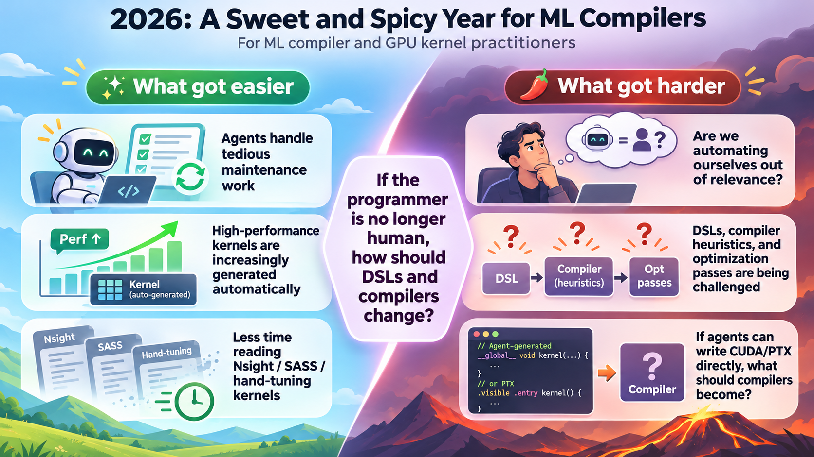
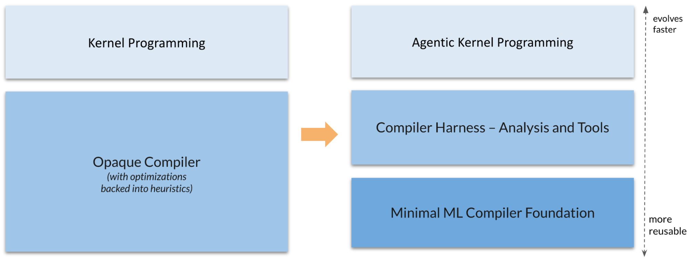
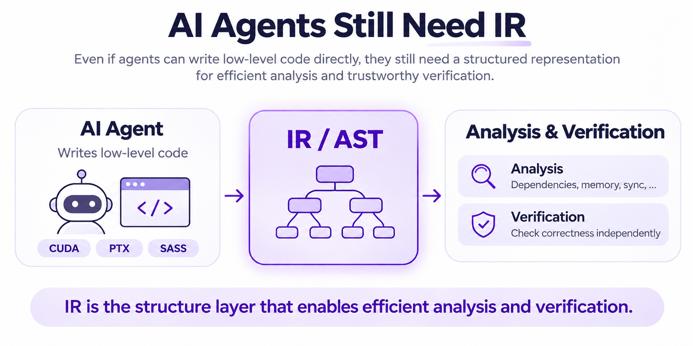
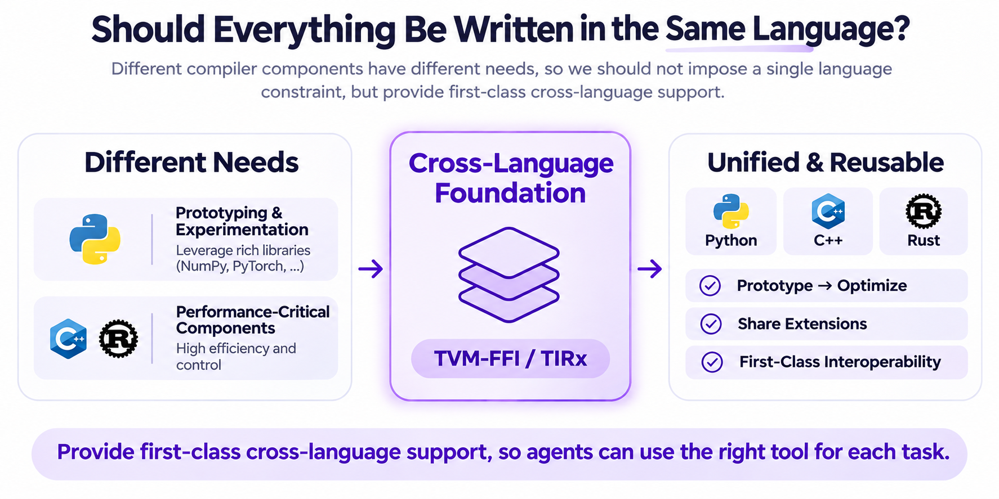
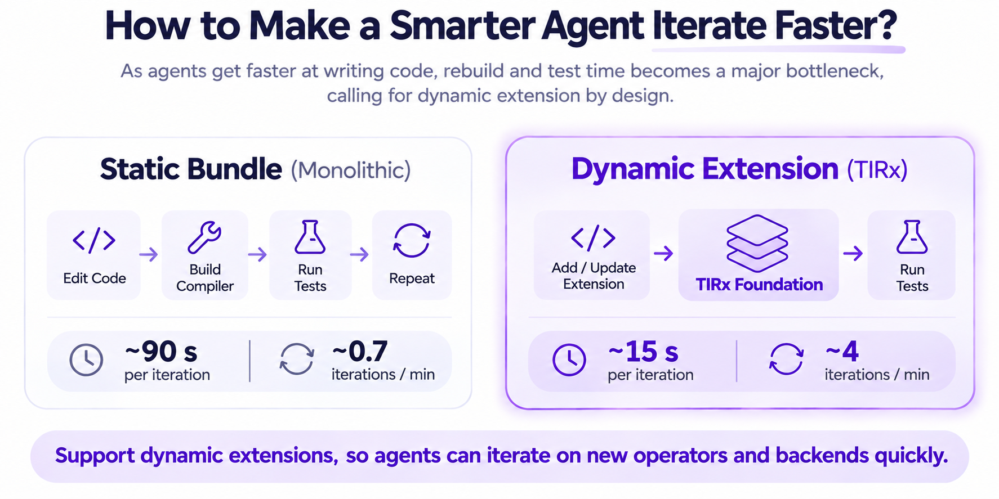
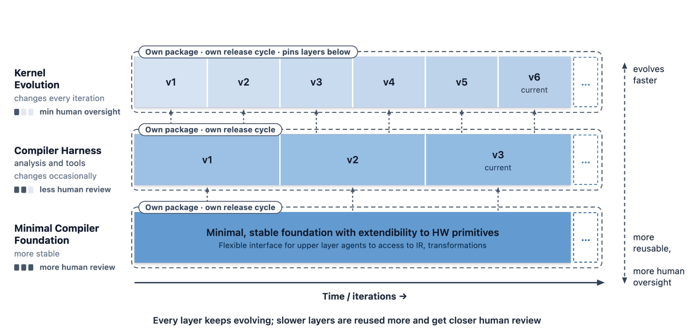
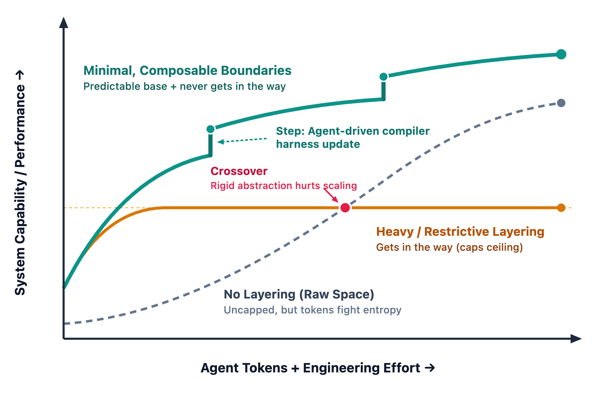

<section class="post-summary" aria-labelledby="tldr" markdown="1">

## TL;DR
{: #tldr }

In our [previous community effort](https://blog.mlc.ai/2026/09/29/tirx-harness-an-open-compiler-harness-for-agentic-gpu-programming), we showed that with little more than Opus 5.5 and a few presses of Enter, we could produce production-quality B200 kernels that significantly outperform existing baselines.

This led us, as ML compiler practitioners, to revisit a fundamental question from first principles: **Do we still need our beloved compilers?**

Our answer is **yes, but perhaps not in the form we know today.** Through concrete case studies and first-principles reasoning, we explore why agents still need compiler abstractions and how these abstractions should be designed for them.

We're putting these ideas into practice through a ground-up rebuild of [TIRx](https://github.com/apache/tvm-tirx/tree/main), with the goal of making it a shared DSL and compiler foundation for agentic kernel development.

</section>

For those of us working on ML compilers and GPU kernels, 2026 has been both an exciting and an unsettling year.

{: style="width: 90%; margin: auto; display: block;" }

On the one hand, much of the tedious maintenance work that once consumed our time can now be delegated to agents. Agents are even tackling the development of high-performance GPU kernels, one of the ultimate goals of our compiler research, with remarkable success. Perhaps we can finally free ourselves from the endless cycle of reading Nsight Compute reports, inspecting SASS assembly, and hand-tuning the most delicate details of GPU kernels. Recent efforts such as [KernelAgent](https://pytorch.org/blog/kernelagent-hardware-guided-gpu-kernel-optimization-via-multi-agent-orchestration/), [CUDA Agent](https://arxiv.org/abs/2602.24286), [Cursor's multi-agent system](https://prod.cursor.com/blog/multi-agent-kernels), [CAKE](https://arxiv.org/abs/2608.12629), [TIRx Harness](https://blog.mlc.ai/2026/09/29/tirx-harness-an-open-compiler-harness-for-agentic-gpu-programming), [KDAgent](https://nvlabs.github.io/kda/), and [EAT](https://arxiv.org/abs/2610.36848) have demonstrated remarkable progress in automated GPU kernel development.

On the other hand, this progress raises an uncomfortable question: **Are we automating ourselves out of relevance?** In the essay [*I Have No Choice but to Bury My Talent in Yesterday*](https://mp.weixin.qq.com/s/zk0KxuLzhmMJ4LPYW_OHMA), DeepSeek engineer Shengyu Liu reflects on the possibility of agents surpassing human experts in kernel development. Meanwhile, Stanford's [*Retire the Abstractions*](https://hazyresearch.stanford.edu/blog/2026-08-05-retire-the-abstractions) questions whether even CUDA DSLs will remain necessary.

This is a particularly uncomfortable thought for those of us who have spent years building DSLs, compiler heuristics, optimization passes, and entire compilation frameworks. Much of this machinery was designed around the needs and limitations of human programmers.

After all, we humans have limited attention and working memory. We cannot easily keep every detail of GPU hardware in our heads, nor can we manually explore thousands of possible optimization strategies. We need high-level abstractions to make low-level programming manageable and compilers to automate the tedious, repetitive, and error-prone parts of optimization.

**But what happens when the programmer is no longer human?**

Agents can work directly with low-level CUDA or PTX, inspect profiling results in seconds, experiment with unconventional optimization strategies, and explore dozens or even hundreds of kernel variants within an hour. They are not constrained by human cognitive limitations in the same way. Why should we expect them to use the same languages, abstractions, and workflows we designed for ourselves?

This brings us to a more fundamental question:

**If agents can handle the low-level details themselves, should we still put a compiler between them and the hardware?**

We believe the answer is **yes, but for a different reason.** Instead of requiring agents to reinvent IR and compiler infrastructure at every iteration of kernel development, a minimal, stable ML compiler foundation can provide shared abstractions and reusable tools for the entire community while leaving agents free to explore their own optimization strategies.

{: style="width: 90%; margin: auto; display: block;" }

In this post, we explain why such a foundation is still needed and how it should be designed for agents. These ideas guided our redesign of TIRx around the following core elements:

- **A minimal, stable set of core AST nodes** designed for common needs and extensions.
- **Stable, predictable utilities** for common needs, including TVM-FFI bridge generation, symbolic integer analysis, structural traversal and mapping, and basic code generation for CUDA and host LLVM targets.
- **Dynamic extension by design:** Types and operations can be easily added without rebuilding a static bundle. Customizations can be developed in independent repositories and loaded dynamically to interoperate with the foundation layer.
- **First-class cross-language support:** Python, C++, and Rust (work in progress). Agents can implement compiler analyses and extensions in any of these languages, quickly prototyping ideas in a dynamic language like Python and then implementing them in Rust or C++. Extensions work out of the box across supported languages.
- **Connections to stable compiler toolchains:** The foundation provides a minimal layer for ML compilation while using the backend capabilities of established toolchains where possible.

This post walks through the design reasoning behind our approach to rethinking the ML compiler foundation for the agentic era. We hope these principles and ideas will be broadly applicable to the ML compiler and agentic development communities.

## Do We Still Need Compilers at All?

The first question we should ask ourselves is whether we really need compilers at all.

Many of the abstractions we designed for DSLs help human programmers manage low-level details. If agents can work directly with CUDA, PTX, or assembly, they may no longer need the same human-oriented programming interfaces.

Agents are also already very good at the heuristic optimizations traditionally performed by compilers and can work directly with low-level code.

{: style="width: 90%; margin: auto; display: block;" }

**But does eliminating a DSL interface or compiler-driven code generation eliminate the need for compiler infrastructure?**

Imagine a future where an agent writes CUDA kernels directly, relies on existing toolchains to generate PTX and SASS, and iterates through profiling and testing. It might even generate PTX or native machine instructions directly, without going through a traditional ML compiler at all.

Now suppose we want to verify that a generated kernel is correct. We cannot simply trust the agent's judgment or rely on tests alone. We still need a formal representation of the program and its semantics, such as an IR formalized in Lean, against which correctness proofs can be checked.

Moreover, we wouldn't want agents to spend hundreds of iterations on programs with obvious bugs. Ideally, we should catch errors as early as possible, using efficient checkers to analyze program patterns, memory accesses, synchronization, and other properties without relying on expensive model reasoning or full formal verification for every candidate (see the [checkers](https://github.com/mlc-ai/TIRx-harness/tree/main/tools) we built).

This thought experiment reveals two important needs that remain even when agents take over code generation:

- **Analysis:** While agents can reason directly over program text, not every analysis needs to be performed through model reasoning. Just as humans can perform arithmetic by hand but benefit from calculators, agents can benefit from structured program representations and efficient analysis algorithms to catch problems early in development.
- **Verification:** Program correctness should not depend on trusting an agent's judgment. Independent verification requires precisely defined program semantics against which correctness claims can be checked.

These two needs motivate a common foundation: a minimal, extensible IR that exposes program structure and semantics to both agents and conventional tools, independently of any particular code generation or optimization strategy.

In this future, **we may no longer need a compiler that actually compiles anything, but we will still need compiler infrastructure to understand and verify programs.** A shared IR can serve as the foundation for analysis, verification, and new tools built by agents.

Our insight is that we need a **minimal, stable set of core IR/AST nodes** designed for common needs and extensions. Whether agents generate CUDA/PTX or eventually native machine instructions, the resulting programs should be representable by introducing new operations into the stable operator system without fundamentally changing the IR infrastructure.

Additionally, the foundation should be able to **connect to stable compiler toolchains** where it makes sense, so we can reuse established backend capabilities when those backends are not a bottleneck.

## How Should We Design ML Compilers for Agents?

One key characteristic of the agentic era is the accelerating pace of development. Agents will become the primary developers of compiler extensions and will try out new ideas. We should rethink what makes compiler code itself easy to develop and maintain.

### Should Everything Be Written in the Same Language?

{: style="width: 90%; margin: auto; display: block;" }

Most of our current compilers are written primarily in one programming language, with supporting wrappers in others. However, an agent implementing different kinds of compiler components may have different needs:

- For experimental analyses that benefit from existing Python libraries such as NumPy or PyTorch, Python would be preferable.
- For frequently executed analysis passes, C++ or Rust may be preferable.

While agents can always reimplement everything in a single language such as C++ or Rust, the tokens spent doing so could be put to better use. Ideally, a global choice of programming language should not constrain local implementation decisions.

These observations highlight the need for **first-class cross-language support**. Built on TVM-FFI, the TIRx foundation provides out-of-the-box, first-class support for Python, C++, and Rust. Agents can prototype in Python, move performance-critical components to C++ or Rust, and reuse extensions across supported languages.

### How Can We Help Agents Iterate Faster?

{: style="width: 90%; margin: auto; display: block;" }

An agent can be very smart, but its iteration speed is fundamentally limited by its development environment and workflow. Suppose an agent wants to add a new operator or experiment with a new backend. Generally, it needs to modify the code, rebuild the compiler, run the tests, and repeat that process. As agents become faster at writing code, rebuilding and testing account for a larger share of the development loop. While mechanisms like build caching can partly alleviate the issue, they do not completely eliminate the overhead.

These needs call for a shift from statically bundled compilers and extensions to **dynamic extension by design.** The TIRx foundation allows types and operations to be added dynamically without rebuilding a monolithic compiler. Extensions can live in independent repositories and interoperate with the foundation, enabling faster development iterations.

### What Will Maintenance Look Like Going Forward?

As agents get better at building compiler components, we should also consider how project maintenance will change. Agents may still need to maintain different, potentially conflicting optimization pipelines tailored to specific domains. There will also be a strong need for compiler harnesses that focus on analysis rather than code transformation. Finally, agents may make optimization decisions themselves rather than relying on heuristic transformations.

There is a **fundamental tension between rapid innovation and the need for stability and code quality**. Kernels can be generated in minutes and discarded, whereas lower layers benefit from stability and closer human oversight.

{: style="width: 90%; margin: auto; display: block;" }

These observations favor structuring projects into layers based on their levels of stability and rates of change. The new ML compiler foundation should provide a minimal, stable, and predictable base for compilation, with extension mechanisms that allow agents to customize the compiler abstractions themselves. Agents can build compiler harnesses and transformations on top and evolve them at a faster rate. The TIRx foundation focuses on:

- **A minimal, stable core AST**, extended through an open operator system.
- **Reusable, predictable utilities**, including symbolic integer analysis, structural traversal and mapping, and TVM-FFI bridge generation.
- **Integration with established toolchains**, including basic CUDA and host LLVM code generation, rather than reimplementing everything within a custom compiler pipeline.

The goal is not to eliminate compiler functionality, but to keep the shared foundation small while letting agents implement and evolve the functionality they need at upper layers.

## Discussion and Looking to the Future

{: style="width: 90%; margin: auto; display: block;" }

We are at a crossroads this year, and predicting where the future will lead is challenging. The approach outlined in this post is likely not the only path forward for ML compilers in the agentic era. As ML compilers transition into this new phase, we must carefully avoid rigid abstractions that restrict agent capabilities, while recognizing that a complete lack of layering leads to unnecessary token expenditure and sloppy outcomes.

Our view is that composable layers can succeed as long as we avoid rigid abstractions that limit agent capabilities. An ML compiler foundation can play a vital role in supporting research and development in ML compilers and agents. We hope TIRx can provide such a foundation and work with the broader ML compiler and agentic development ecosystems.

## Technical Details

The previous section discusses the overall design motivation. This section walks through some of the technical design elements with code examples. For readability, the technical details are collapsed below.

<details class="technical-details" markdown="1">
<summary>Technical details and code examples</summary>

TIRx offers a complete interface to construct typical tensor programs in Python:

```python
from tvm_tirx.script import tirx as T

n = T.dynamic("n")

@T.function
def add_one(A: T.Tensor((n,), T.float32), B: T.Tensor((n,), T.float32)):
    for i in range(n):
        B[i] = A[i] + 1
```

The example above constructs a function object representing an add-one operation on the CPU. TIRx provides a built-in API to compile the function into code that interoperates with libraries in the Python array API ecosystem, such as NumPy and PyTorch.

```python
import torch
import tvm_tirx as tirx

add_one_compiled = tirx.compile(add_one, target="llvm")
a = torch.arange(10, dtype=torch.float32)
b = torch.empty(a.shape, dtype=a.dtype)
add_one_compiled(a, b)
```

Our design aims to be **minimal, faithful, and predictable**. A call to `tirx.compile` applies no additional heuristic optimizations; the program is passed directly to the LLVM compiler toolchain to generate CPU code.

The examples so far show how TIRx can be used as a typical opaque domain-specific compiler. As mentioned earlier, our goal is to expose not only the programming interface but also the compiler API and every intermediate AST object to developers and agents. We store every AST node in a **cross-language object** backed by TVM FFI, making it directly accessible from languages including Python, C++, and Rust. The following code shows how we can inspect program structures such as types and shape values:

```python
# query the type of parameter A
ty_A = add_one.params[0].ty
# query the length of parameter B
n = add_one.params[1].ty.shape[0]
```

### Common Utilities for Traversal, Mapping, and Analysis

Direct access to internal compiler objects allows us to inspect and transform programs further. We use a set of lightweight, general-purpose utilities built into TIRx and TVM FFI to traverse, compare, and transform program structures. For example, the following code snippet specializes the dynamic dimension `n` to 128:

```python
import tvm_ffi
import tvm_tirx

add_one_specialized = tvm_ffi.structural_map(
    add_one,
    (tvm_tirx.ir.Var, lambda v: 128 if v.same_as(n) else v),
)

add_one_specialized.show()
```

```python
@T.function
def add_one(A: T.Tensor((128,), T.float32), B: T.Tensor((128,), T.float32)):
    for i in range(128):
        B[i] = A[i] + 1
```

Symbolic shapes and indices are common in both kernels and higher-level programs. TIRx's representation allows types like `TensorType` to depend on expression values, and we provide common utilities to check symbolic relations during program analysis. Thanks to feedback from the TileLang community, we have also added structural traversal variants with symbolic constraint contexts and stronger Z3 proofs. These tools are designed to work with dynamic TVM FFI objects, so they continue to function as the set of AST nodes expands, whether in the main project or in downstream projects.

At every stage of compilation, the program can be printed in Python script syntax, as shown above. This allows agents and developers to inspect intermediate programs, experiment with transformations, and build new ones.

### Dynamic Extension through Types and Operations

While the compiler foundation provides a minimal backbone, TIRx is designed to accommodate new customizations both in-tree and downstream. The primary way to extend the TIRx foundation is to introduce new types and operations. Downstream projects can define new types as TVM-FFI objects that subclass the original type node and carry additional type and expression information. For example, we introduced `tirx.TensorMapType` to support TMA tensor maps in CUDA programs.

Because new types can carry information that depends on other types and expressions, they can preserve that information across intermediate stages of compilation. A typical approach is to lower these intermediate types to existing types or add dedicated backend code generation support for the new types. To maintain simplicity and consistency, we allow Python type constructors to be used directly in the script syntax. For instance, `T.Tensor((n,), T.float32)` simply invokes the type constructor with a tuple and `T.float32` to obtain an instance of the concrete type.

Most extensions introduce new operations (ops). An op can be used in either a `Call` AST node, resembling an intrinsic call, or a `RegionStmt`, defining a region with additional semantics such as a thread launch or kernel region. We built minimal CUDA and PTX support by introducing the `device_entry` region op and representing calls to `T.ptx.add.rn.f32` as `Call` nodes for the corresponding PTX op.

```python
from tvm_tirx.script import tirx as T

n = T.dynamic("n")

@T.function
def add_one(A: T.Tensor((n,), T.float32), B: T.Tensor((n,), T.float32)):
    T.device_entry(
        launch=T.cuda.LaunchConfig(grid=((n + 255) // 256,), block=(256,))
    )
    i = T.cuda.block_idx("x") * 256 + T.cuda.thread_idx("x")
    if i < n:
        T.ptx.add.rn.f32(B[i], A[i], T.float32(1))
```

As an example of these dynamic extension capabilities, we registered most ops in the `T.ptx` namespace directly through Python, allowing us to update compiler support quickly without modifying the core library.

Both type and operator registrations support dynamic extension through runtime tables indexed by string keys. This setup allows us to build extensions as downstream packages that depend on the compiler foundation without needing to recompile or bundle the original project. This separation enables different modules to evolve at different rates. The ML compiler foundation contains reusable code that is continuously hardened, while agents can independently iterate on new compiler harness ideas.

### First-Class TVM FFI Host ABI Support

Every new ML compiler or harness needs a way to connect to the broader ecosystem. TVM FFI provides standard ABI and FFI support for interoperability. The TIRx foundation provides shared utilities for generating host code compatible with the TVM FFI ABI. This is particularly useful for generating efficient compiled tensor checks. For example, the following code declares a `2 * n` shape constraint on an input tensor. The compiled function produces a clear error message when an input violates this constraint.

```python
import torch
import tvm_tirx as tirx
from tvm_tirx.script import tirx as T

n = T.dynamic("n")

@T.function
def add_one(A: T.Tensor((2 * n,), T.float32), B: T.Tensor((2 * n,), T.float32)):
    for i in range(2 * n):
        B[i] = A[i] + 1

add_one_compiled = tirx.compile(add_one, target="llvm")
a = torch.arange(11, dtype=torch.float32)
b = torch.empty(a.shape, dtype=a.dtype)
add_one_compiled(a, b)
```

```text
ValueError: Invalid A.shape[0] on argument #0 when calling:
   `add_one(A: Tensor([2 * n], float32), B: Tensor([2 * n], float32))`,
   expected A.shape[0] to be divisible by 2
```

While agents can easily rebuild support for new variants on the fly, these foundation features remain stable and continue to be hardened, allowing agents to focus on developing new compiler features and analyses while relying on established pipelines.

</details>

## Acknowledgements

This post summarizes work by many contributors across the TVM and broader ML communities. It was written by a human, with GenAI models assisting with grammar and style edits.

## Links

- GitHub (work in progress): [https://github.com/apache/tvm-tirx/](https://github.com/apache/tvm-tirx/)
