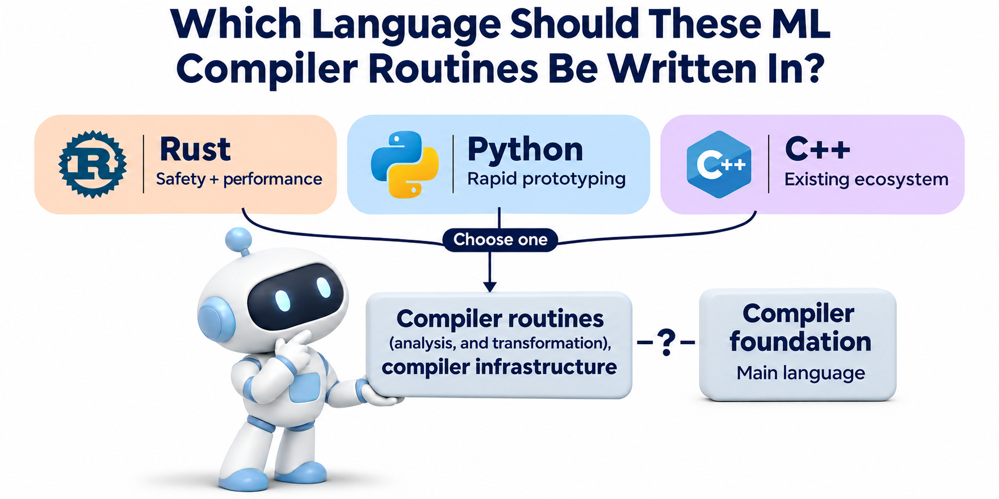
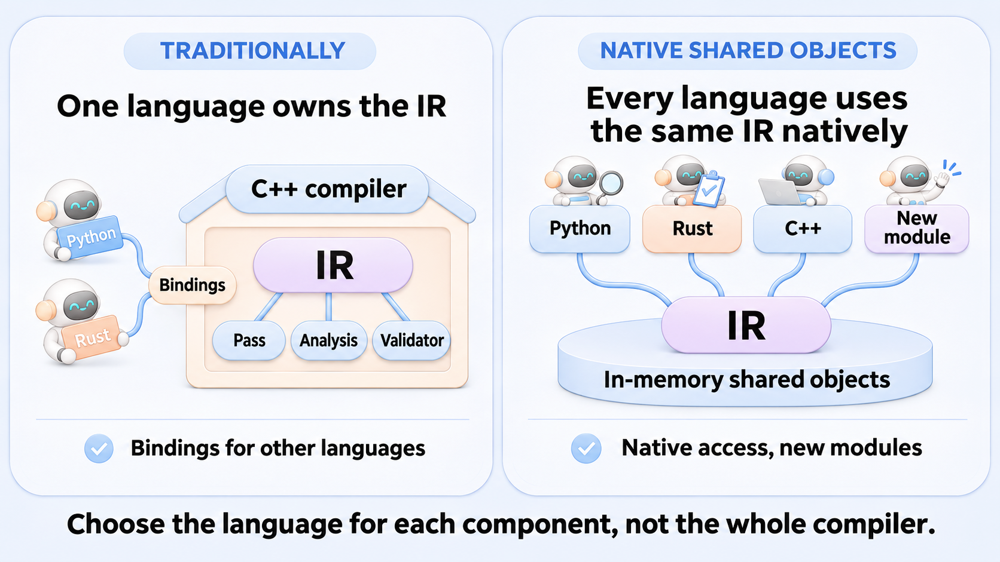
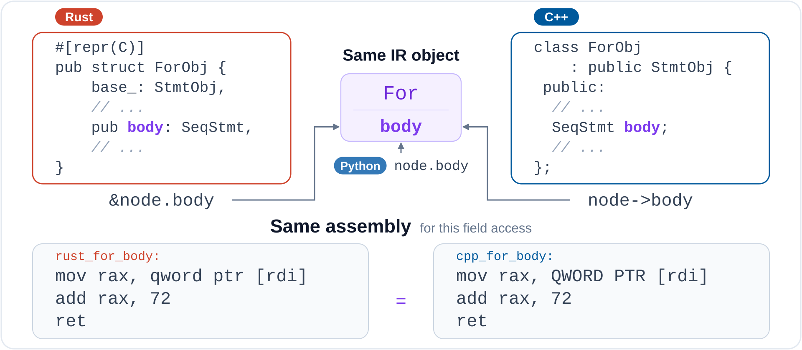
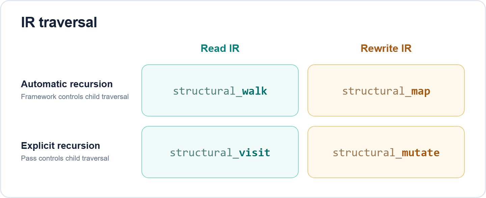
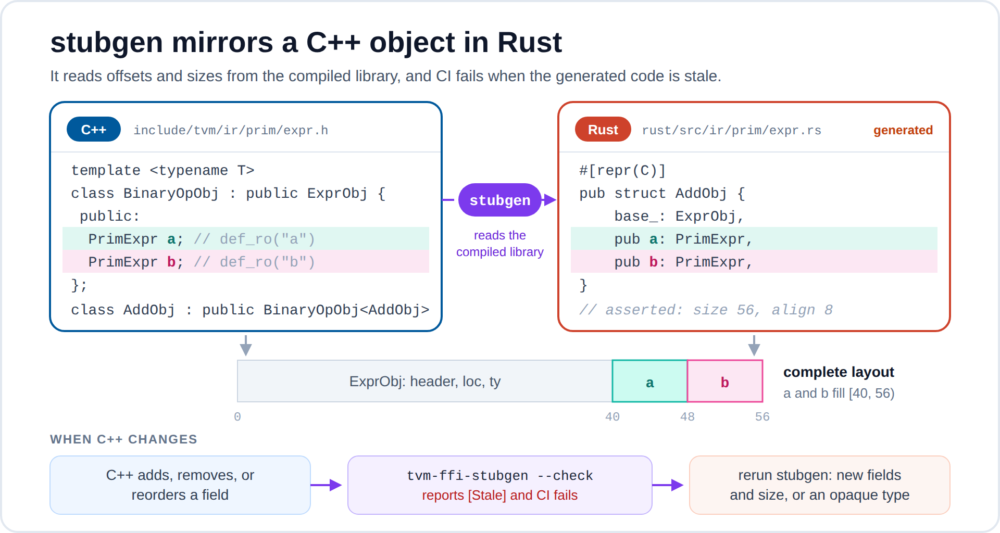
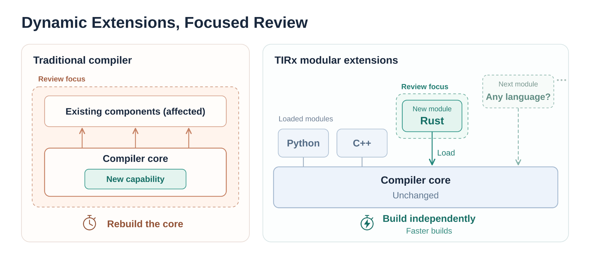
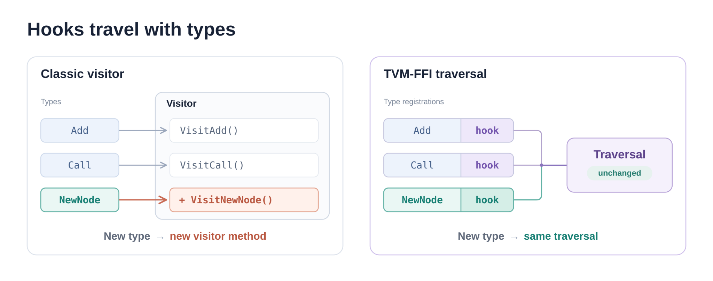
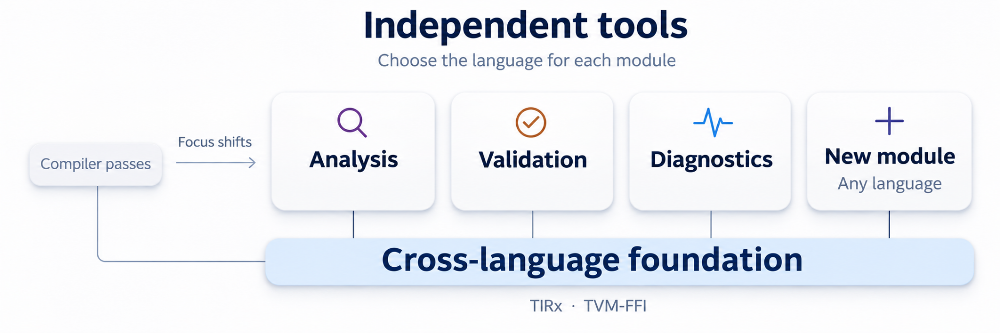

Recent work on agent-driven kernel generation and systems optimization has shown that coding agents can take on substantial systems development. With agents writing a growing share of systems code, validating its correctness has become an increasingly important problem. As we discussed in [our recent post "Rethinking Abstractions in the Agentic Era"](https://tvm.apache.org/2026/11/03/rethinking-abstractions-in-the-agentic-era), **ML compiler foundation will continue to play a central role in the agentic era,** to inspect, verify, and transform the programs that agents generate.

One natural consequence is that agents should now be able to get access to the intermediate program representations (IR), such as loops and calls and write customized compiler routines. In this scenario, the compiler foundation no longer only serves the human developers and increasingly becomes agent facing. One natural question arises: **which programming language should agents pick to write ML compiler routines in?**

{: style="width: 90%; margin: auto; display: block;" }

Many language options are available and each comes with its own tradeoffs:

**Rust** is a very natural choice, as its safety guarantees enable us to catch memory bugs early while maintaining high performance in programming. Its ownership and borrowing rules, static type system, and concurrency guarantees prevent many memory-safety errors and data races at compile time. Not surprisingly, we start to see a big movement of rewriting systems entirely onto Rust with the help of AI agents. The safety and efficiency seems to make Rust the language of choice.

**Python** remains a strong choice, and is still the language in machine learning land, thanks to its rich ecosystem, and dynamic nature to enable quick prototyping. The ability to quickly prototype helps to cut down agent iteration time greatly.

**C++** continues to have a strong base and admittedly the best infrastructure support for low-level compiler tool chains. As a matter of fact, the vast majority of production compiler frameworks are still written in C++, thanks to established frameworks like LLVM infrastructure.

Traditionally, most compilers are built around a single main language. The IR and other core data structures are defined in that language, typically C++, and languages such as Python reach them through bindings or wrappers. As we can see in the above discussion, there is not a really clear winner in terms of languages. In our experience agents would favor Python for prototyping, and Rust/C++ for robust stable implementations.

The above observations make us ask one question: **why not natively support multiple languages?** Our main insight is that most of the compiler routines operate on trees of nodes that represent the program, which we call IR, if we can **enable in-memory, zero-cost access to these IR node objects across languages**, **and build first-class ergonomic APIs around them**, we will be able to enable a first class cross language foundation that works across Rust, C++ and Python.

{: style="width: 90%; margin: auto; display: block;" }

To understand how it works, it is helpful to distinguish our approach from traditional ones. Most traditional ML compilers would build solutions in one primary language, while exposing bindings to others. Those bindings typically bring additional indirections and may not present an idiomatic API for all the features needed. Instead, we want to provide **fine-grained native access to the IR objects**. Concretely, a Rust module should work on the same objects as a C++ pass, whether IR nodes or other compiler data structures, and read their fields directly. This calls for an agreement that sits below any single language. We build our solution on top of [TVM-FFI](https://tvm.apache.org/ffi/), an open ABI for ML systems. Through its C ABI, **every language shares the same reference-counted objects, and a registry records each type's fields and where they sit in memory**. Any library can add types to this registry when the library loads. A Rust library can therefore read C++ objects in place and contribute new types of its own.

{: style="width: 90%; margin: auto; display: block;" }

We call our effort **TIRx Rust, a Rust-Native, Cross-Language Foundation for Agentic ML Compilers**. TIRx Rust builds on top of TIRx, a minimal and stable ML compiler foundation, while providing cross-language native IR access, ergonomic Rust APIs, and dynamic extension.

We envision a fundamentally new way to explore ML compiler development with the help of agents: **instead of completely rewriting everything into one language like Rust, we allow agents to pick the best language** for different modules at different stages of development while being able to mix and match at fine grained levels. Our preliminary experiences show that this approach empowers agents to develop faster with python prototyping, building robust code with Rust, while connecting to stable compiler toolchains in C++ organically.

## Building Ergonomic Rust APIs

While the TVM-FFI ABI provides a basic way to access the data structures, we still need to provide idiomatic and safe Rust APIs to inspect, traverse and transform the program structures. Each of the IR objects in Rust is stored as a reference counted object that follows Rust's ownership rules. Different IR nodes can be represented by different node types.

One typical need in compiler analysis is to take a node dispatch based on its type, whether it is a For node, a constant or expression. The `match_any!` macro matches the IR node type:

```rust
fn describe(expr: &PrimExpr) -> Result<String> {
    let text = match_any! {
        expr {
            Add(ref add) => format!("({} + {})", describe(&add.a)?, describe(&add.b)?),
            Mul(ref mul) => format!("({} * {})", describe(&mul.a)?, describe(&mul.b)?),
            Var(ref var) => var.name.as_str().to_owned(),
            IntImm(ref imm) => imm.value.to_string(),
            _ => "<other>".to_owned(),
        }
    };
    Ok(text)
}
```

The `match_any!` behaves, much like a `match` on an enum, one difference is that in our case, we do not require to enumerate enum ahead of time, instead, different downstream extensions can build their own variant of IR objects in different dynamic libraries and `match_any!` will work out of the box for them. This dynamic extension ability is extremely important as agents organically grow the program representations without having to rebuild the full program.

Besides `match_any!`, we also provide `#[dispatch]` macro that enables us to build type based dispatch easily in Rust. Such a pattern is very commonly used in visitors in most compiler analysis.

```rust
#[dispatch(print, (AnyView<'_>, bool), String)]
impl Printer {
    fn print_add(&self, add: &Add, nested: bool) -> String {
        let text = format!("{} + {}", self.show(&add.a, true), self.show(&add.b, true));
        if nested { format!("({text})") } else { text }
    }

    fn print_var(&self, var: &Var) -> String {
        var.name.as_str().to_owned()
    }

    fn print_imm(&self, imm: &IntImm) -> String {
        imm.value.to_string()
    }

    fn show(&self, expr: &PrimExpr, nested: bool) -> String {
        let text = self.dispatch(AnyView::from(expr), nested);
        text.unwrap_or_else(|| "<other>".to_owned())
    }
}
```

`match_any!` and `#[dispatch]` provide us with the basic API to access and dispatch handling at each step. In practice, we also need to recursively traverse the IR nodes and perform inspection and rewriting. We provide **structural traversal APIs** through four [`structural_*`](https://tvm.apache.org/ffi/guides/rust_lang_guide.html#structural-walk-and-visit):

{: style="width: 70%; margin: auto; display: block;" }

`structural_walk` and `structural_visit` read the IR, and `structural_map` and `structural_mutate` rewrite it. Of these, `structural_walk` and `structural_map` traverse the child nodes automatically, and the other two give users full control over the traversal order. Here is an [example](https://tvm.apache.org/tirx/ir_guides/working_with_ir_in_rust.html#structural-walk) to show the `structural_walk`:

```rust
#[derive(Default)]
struct Counter {
    vars: usize,
    adds: usize,
}

#[dispatch(walk, (AnyView<'_>, DefRegionKind), Result<WalkResult>)]
impl Counter {
    fn walk_var(&mut self, _var: &Var) -> Result<WalkResult> {
        self.vars += 1;
        ...
        Ok(WalkResult::Advance)
    }

    fn walk_add(&mut self, _add: &Add) -> Result<WalkResult> {
        self.adds += 1;
        Ok(WalkResult::Advance)
    }
}
fn count() -> Result<tvm_ffi::String> {
    ...
    tvm_ffi::structural_walk(&expr, &mut counter, WalkOrder::PreOrder)?;
}
```

Combined with `#[dispatch]` or typed function closures, these traversals can form the core of a pass.

Beyond the ergonomic APIs, two questions remain. How do Rust and C++ keep object layouts in sync, and how do the traversals reach nodes whose types they have never seen?

### Technical Details

<details class="technical-details" markdown="1">
<summary>The same analysis in Python, C++, and Rust</summary>

We will use the [`add_one`](https://tvm.apache.org/tirx/ir_guides/overview.html) example to show the APIs in several languages.

`add_one` uses a loop to compute `B[i] = A[i] + 1`. In each language, the same analysis collects the tensors `add_one` writes and finds `B`:

[**Python**](https://tvm.apache.org/tirx/ir_guides/structural_utilities.html#structural-walk)

```python
writes = []


def on_store(store):
    writes.append(store.dest.name)


tvm_ffi.structural_walk(add_one, (ir.TensorStore, on_store))
print(writes)
```

[**C++**](https://tvm.apache.org/tirx/ir_guides/working_with_ir_in_cpp.html#structural-walk)

```cpp
ffi::Array<ffi::String> TensorsWritten(const tirx::Function& func) {
  ffi::Array<ffi::String> writes;
  ffi::StructuralWalk<ffi::WalkOrder::kPostOrder>(
      func, [&](const TensorStore& store) -> ffi::Expected<ffi::WalkResult> {
        writes.push_back(store->dest.as<VarObj>()->name);
        return ffi::WalkResult::Advance();
      });
  return writes;
}
```

[**Rust**](https://tvm.apache.org/tirx/ir_guides/working_with_ir_in_rust.html#structural-walk)

```rust
fn written_tensors(func: Function) -> Result<Strings> {
    let mut writes = Vec::new();
    let on_store = |store: TensorStore| -> Result<WalkResult> {
        let dest = Var::try_from(&store.dest)?;
        writes.push(dest.name.clone());
        Ok(WalkResult::Advance)
    };
    tvm_ffi::structural_walk(&func, on_store, WalkOrder::PostOrder)?;
    Ok(writes.into_iter().collect())
}
```

In Rust, `store.dest` **is a plain field read** with no wrapper call, even though `TensorStore` and `Var` are defined in C++. This is the fine-grained access that bindings make expensive.

All three versions call `structural_walk`, one of the four traversal entry points introduced earlier. It walks the whole IR and calls the callback only on nodes of the selected type.

</details>

### Verified Layout Equivalence: Native Access Without Manual Synchronization

Reading a C++ object's field directly from Rust works only if the **Rust mirror of the class has exactly the same layout as the C++ definition**: the same size and alignment, and every field at the same offset. However, the C++ compiler determines this layout from details Rust never sees, such as inheritance, templates, and padding.

If we maintain this mirror by hand, it can silently fail: once a C++ field moves, Rust code keeps reading from the old offset, which is undefined behavior. To stay in sync, the mirror should ideally be derived from the actual memory layout of C++ objects and updated automatically when the C++ definition changes.

TIRx **generates this mirror automatically**. TVM-FFI records each reflected type's layout, as the C++ compiler computed it, in the compiled library. When running `tvm-ffi-stubgen --target rust`, its stubgen tool reads this layout and generates matching type definitions for other languages, including Rust structs.

Every struct that stubgen generates matches the C++ layout exactly. To guarantee this, stubgen first checks that the type has a complete layout: apart from padding, its reflected fields fill every byte from the end of its parent to the end of the type. For example, `prim.Add` has a complete layout, since its parent `ir.Expr` ends at byte 40 and `a` and `b` fill `[40, 56)`. Stubgen will also automatically add assertions to check that the struct for `prim.Add` has the same size and alignment as in C++.

{: style="width: 90%; margin: auto; display: block;" }

**Rust thus works with shared IR objects natively.** Both languages hold pointers to the same allocation, and each Rust field read is one memory load at the offset C++ uses. Rust can allocate these objects too: stubgen generates a constructor that sets each field directly. However, if a type needs the logic in its C++ constructor, we write its Rust constructor by hand.

A type with an incomplete layout gets no struct and stays opaque behind C accessors, but most node types the pass works with **have complete layouts**. The generated structs also cannot silently go stale, because CI rechecks them from the library it has just built and fails on any difference. That settles field access.

## Dynamic Extension: Extending the Compiler Without Rebuilding Its Core

Agents often need new IR abstractions, such as a new data type or an operator for a new hardware feature. In a traditional compiler written in C++, adding one changes the core. The core must then be rebuilt and every component that depends on it updated, so a review has to cover all of that code. When agents write many modules that extend the compiler independently, these costs recur with every module. We would rather **keep each extension in its own module,** so that a reviewer **only needs to focus on that module alone.**

To address this, TIRx lets a module register new IR types, operators, and passes when it loads, the same way TIRx registers its own built-in types. Each module, whether written in Python, C++, or Rust, is built and loaded on its own. Once it loads, the existing infrastructure finds its additions through TVM-FFI. As a result, developers need to rebuild only the module they change, while the core and every other module stay untouched.

{: style="width: 90%; margin: auto; display: block;" }

Dynamic extension also poses a new challenge for traversing and rewriting the IR, which nearly every compiler pass relies on. A traditional visitor does this by listing every node type it knows, which breaks once modules add types dynamically. If a module adds a new statement type, a visitor either fails on the new node or skips it. A validator written the same way would approve a kernel it never fully checked. And the module cannot fix this itself, because it cannot add its new type to visitors written before it.

To support dynamic extension in structural traversals, **TVM-FFI moves the knowledge of how to traverse a node out of passes and into node types.** Each node type records data in the TVM-FFI registry, like which of its fields are children. Most TIRx node types record this with a compiled hook, and types without one will fall back to their reflected fields. The traversal engine looks up this description by each node's type index, so it can walk a node without knowing its concrete type:

{: style="width: 90%; margin: auto; display: block;" }

The figure above compares the two approaches. A traditional visitor lists every node type it handles, so each new type needs a new visit function in every visitor. In TVM-FFI, each type has a traversal description, and existing traversals pick it up automatically. Structural utilities **keep working with new node types**; only passes that interpret a new type need new code.

### Technical Details

<details class="technical-details" markdown="1">
<summary>Walkthrough: adding complex numbers with a Rust extension</summary>

Next, we will use an example to show how to utilize dynamic extension in TIRx with Rust.

The [extension example](https://github.com/apache/tvm-tirx/tree/main/examples/extension_guides/rust) is such a module: a Python package adding complex numbers based on TIRx in **about 260 lines of safe Rust**. With it, a kernel multiplies complex numbers stored as real and imaginary float32 arrays:

{: style="width: 90%; margin: auto; display: block;" }

**The IR type.**

It starts with `ComplexType`, defined in Rust:

```rust
/// A complex number whose real and imaginary parts share a scalar type.
#[rs_object(type_key = "my_ext.ComplexType", final, immutable)]
pub struct ComplexTypeObj {
    base_: TypeObj,
    pub dtype: PrimType,
}
#[derive(Clone, tvm_ffi::derive::ObjectRef)]
#[object_ref(parent = Type)]
pub struct ComplexType {
    data_: tvm_ffi::ObjectArc<ComplexTypeObj>,
}

tvm_ffi::static_init_block! {
    register_type::<ComplexType>()?;
}
```

The `#[rs_object]` macro gives it a `#[repr(C)]` layout and registers it on load with parent `ir.Type` and reflected field `dtype`. Then, `register_type` exposes it to Python as `my_ext.Complex`, and other languages reach it through the shared object system.

**The operators.**

`complex` constructs a value, `cmul` multiplies two, and `real` and `imag` take parts. Each is an `OpDef` chain:

```rust
tvm_ffi::static_init_block! {
    OpDef::new("my_ext.complex", "Construct the complex number re + im * i.")
        .signature((
            sig::arg::<sig::PrimExpr>("re", "The real part."),
            sig::arg::<sig::PrimExpr>("im", "The imaginary part."),
        ))
        .set_infer_type(infer_complex)
        .set_validator(validate_call)
        .set_attr(CALL_EFFECT_KIND, CallEffectKind::Pure);
}
```

The chain registers the operator together with two Rust functions. `infer_complex` infers a call's result type and raises a `TypeError` on a bad argument when the call is constructed, and `validate_call` rechecks a call on request, as `map_call` does below. TIRx also generates the operator's Python builder from this entry.

**Structural traversal.**

`ComplexType` registers no structural hooks, so the structural utilities traverse it through its reflected field `dtype` automatically. Existing traversal code reaches complex values without being recompiled.

**The lowering pass.**

The original codegen component knows nothing about complex values, and cannot generate code for them. So the extension also needs to provide a pass, `LowerComplex`. Here, `Lowering` is a `#[dispatch]` struct, and runs through `structural_map` in post-order, so operands are lowered before their uses.

It turns each complex value into two float32 values, leaving only scalar operations: `bindings` maps complex variables to scalar pairs, `parts` returns an operand's parts, and `map_call` rewrites `cmul` into the scalar formula and `real` or `imag` into the matching part:

```rust
#[dispatch(map, (AnyView<'_>,), Result<UnchangedOr<Any>>)]
impl Lowering {
    fn map_call(&mut self, call: Call) -> Result<UnchangedOr<Any>> {
        if is_complex_op(&call.op)? {
            validate_call(&call)?;
        }
        if call.op.same_as(&Op::get("my_ext.cmul")?) {
            let (a, b) = self.parts(&call.args[0])?;
            let (c, d) = self.parts(&call.args[1])?;
            // (a + bi)(c + di) = (ac - bd) + (ad + bc)i
            let re = &a * &c - &b * &d;
            let im = &a * &d + &b * &c;
            return Ok(Call::new(
                None,
                Op::get("my_ext.complex")?,
                [re, im],
                None,
                Vec::<Type>::new(),
                call.loc.clone(),
            )?
            .into());
        }
        let real = call.op.same_as(&Op::get("my_ext.real")?);
        if real || call.op.same_as(&Op::get("my_ext.imag")?) {
            let (re, im) = self.parts(&call.args[0])?;
            return Ok(if real { re.into() } else { im.into() });
        }
        Ok(call.into())
    }
    ...
}
```

`map_bind`, omitted above, splits `z = complex(a, b)` into `z_re = a` and `z_im = b`. Then a second `structural_map` rejects any leftover complex type or operator, such as a complex parameter, with a `ValueError`.

**The compilation pipeline.**

Finally, the pass must reach the compiler. Rust wraps `lower_function` as a pass and exports it:

```rust
fn lower_complex() -> Result<Pass> {
    let pass = FunctionPass::new(lower_function, PassInfo::new(0, "my_ext.LowerComplex"));
    Ok(Pass::from(&pass))
}

tvm_ffi::tvm_ffi_dll_export_typed_func!(lower_complex, lower_complex);
```

On the Python side, `my_ext` sets up its builders with two internal `_init_exposed_*` calls and then loads the library, which runs its registrations.

```python
_init_exposed_op_api("my_ext", __name__, wrapper=auto_emit_void_call)
_init_exposed_type_api("my_ext", __name__)
_LIB = load_lib_module("my-ext", "my_ext", extra_lib_paths=[Path(__file__).parent])
```

The package then composes `LowerComplex` with the existing TIRx pipeline, ahead of the default lowering:

```python
def _pipeline(*, target=None):
    lower, finalize_host, finalize_device = tirx.get_tir_pipeline("default", target=target)
    return ir.transform.Sequential([lower_complex(), lower]), finalize_host, finalize_device


tirx.register_tir_pipeline("my_ext", _pipeline)
```

A single call compiles the kernel with the existing LLVM backend, and its outputs match NumPy:

```python
compiled = tvm_tirx.compile(complex_product, target="llvm", pipeline="my_ext")
```

The extension lives in its own package. **Importing `my_ext` adds a type, four operators, and a pass, while TIRx's core stays unchanged.**

</details>

## Discussion and Looking Ahead

We expect agents' compiler work to shift from general optimization passes toward analysis tools. For decades, compilers have improved programs through passes written once and applied everywhere. Agents now optimize individual kernels directly, so the harder question becomes whether the code they produce is correct. Answering it takes analyses and validators.

[TIRx Harness](https://github.com/mlc-ai/TIRx-harness), an open compiler harness for agentic GPU programming, already builds such tools on TIRx Rust. Its CPU simulator, NumSim, reads a kernel through a Rust frontend written with the APIs in this post and transpiles it into native Rust. Synccheck and Racecheck share this simulation to find synchronization errors and memory races before the kernel runs on a GPU. The [compiler analysis documentation](https://tirxharness.mlc.ai/docs/components/tools.html) describes these tools in detail.

{: style="width: 90%; margin: auto; display: block;" }

**This is why we see cross-language development as the direction for ML compilers.** Analysis tools tend to be numerous, small, and written for a single task, so agents may reach for whichever language fits. Instead of asking every tool to adopt the compiler's language, TIRx gives each language direct access to the same IR, and lets new modules join without touching the core.

**TIRx lets Rust grow alongside the existing code instead of replacing it.** New components can be written in Rust today, and the core infrastructure keeps working beneath them. Agents and the languages they prefer will keep changing. But a cross-language foundation lets them collaborate well with each other.

## Links

- GitHub: [apache/tvm-tirx](https://github.com/apache/tvm-tirx)
- Working with IR in Rust: [TIRx documentation](https://tvm.apache.org/tirx/ir_guides/working_with_ir_in_rust.html)
- TIRx Harness: [mlc-ai/TIRx-harness](https://github.com/mlc-ai/TIRx-harness)
